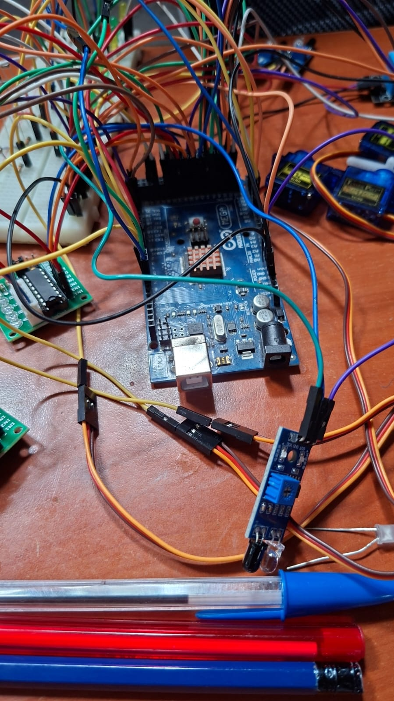
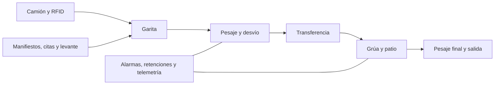
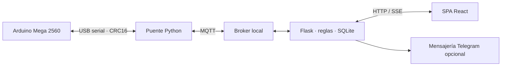

# PORTUS | Terminal portuaria inteligente a escala

PORTUS es un prototipo académico de una terminal de contenedores. Integra una maqueta controlada por Arduino Mega 2560, una plataforma de operaciones en Raspberry Pi 3 y módulos de monitoreo ambiental y visión artificial. El proyecto se desarrolló para el Laboratorio de Arquitectura de Computadoras y Ensambladores 2 de la Universidad de San Carlos de Guatemala, en tres fases que van del control físico local a la supervisión conectada.

> **Estado del proyecto:** las tres fases están terminadas según confirmación del equipo responsable. La suite aislada de la plataforma y la lógica de fase 3 pasó 34 pruebas y 12 escenarios. La integración física y los escenarios E01–E13 fueron confirmados por el equipo; las mediciones y capturas individuales no están publicadas en este repositorio. La [bitácora](docs/Fase3/BITACORA-Y-EVIDENCIAS.md) detalla el alcance de la evidencia disponible.



## ¿Qué problema modela?

Una operación portuaria combina decisiones documentales y movimientos físicos: identificar el camión, verificar su carga, pesarla, autorizar su ingreso, mover el contenedor y conservar trazabilidad hasta la salida. PORTUS reproduce ese recorrido en una maqueta. Separa las decisiones de negocio, que pueden depender de una base de datos y varios roles, de los movimientos y enclavamientos que deben responder directamente a sensores.



El flujo usa **máquinas de estado**: cada estación avanza al recibir una lectura o completar una acción, sin detener todo el controlador en esperas. El pesaje filtra muestras de dos celdas HX711 y busca una meseta estable; la grúa confirma posiciones con una marca óptica y el contacto con la carga; el patio contrasta su inventario lógico con sensores LDR. Un paro de emergencia físico y los límites de movimiento se atienden en el Arduino, aun si falla la aplicación web.

## Recorrido por las fases

| Fase | Qué aporta | Dónde empezar |
| --- | --- | --- |
| **1 · Control de la maqueta** | Firmware modular para RFID, garita, pesaje dinámico, aguja desviadora, grúa, patio, semáforos y salida. Modelos de camiones, contenedores, manifiestos y turnos precargados para la demostración. | [Arquitectura](docs/Fase1/ARQUITECTURA.md) · [instalación](docs/Fase1/INSTALACION.md) · [firmware](PortusFase1_INO/PortusFase1/PortusFase1.ino) |
| **2 · Terminal conectada** | Puente serial–MQTT, API Flask, SQLite, eventos en vivo por SSE, SPA React, permisos por rol, retenciones, alarmas, citas, reportes y mensajería al transportista. Incluye controlador simulado para pruebas sin maqueta. | [Documento técnico](docs/Fase2/DOCUMENTO-TECNICO.md) · [manual de despliegue](docs/Fase2/MANUAL-DESPLIEGUE-Y-PRUEBAS.md) · [código](PortusFase2/) |
| **3 · Ambiente y visión** | Estación con DHT22, sensor de lluvia y LDR por ADS1115; control de iluminación y suspensión por lluvia; OCR de placas, conteo de vehículos y verificación de ingreso. Incluye modelos 3D y guía del montaje. | [Documento técnico](docs/Fase3/DOCUMENTO-TECNICO.md) · [guía de montaje](docs/Fase3/GUIA-MONTAJE-Y-PRUEBAS.md) · [inventario 3D](docs/Fase3/INVENTARIO-FABRICACION-3D.md) |

### Fase 1: control cercano al hardware

El Arduino Mega 2560 ejecuta las máquinas de estado de las estaciones. Timer2 coordina el muestreo del pesaje y los pasos de la grúa; el bucle principal actualiza cada módulo sin `delay()`. La garita relaciona el UID RFID con un manifiesto, el pesaje determina si la carga está dentro de tolerancia y la aguja conduce el camión a transferencia o retención. La grúa mueve contenedores entre la zona de transferencia y un patio lineal de dos posiciones y dos niveles. El inventario cambia tras confirmación física. La [calibración](docs/Fase1/CALEBRACION.md), los [pines](docs/Fase1/DIAGRAMA-PINES.md) y los [comandos de consola](docs/Fase1/COMANDOS-consola.md) están documentados por separado.

### Fase 2: coordinación y trazabilidad

La Raspberry Pi 3 conecta el controlador con servicios de nivel superior. El puente serial valida tramas con número de secuencia y **CRC16-CCITT**, publica eventos en MQTT y transporta comandos. Flask conserva turnos, manifiestos, declaraciones, citas, patio, alarmas y telemetría en SQLite. Los clientes reciben cambios por **Server-Sent Events**. React presenta vistas para terminal, naviera, agente aduanero y autoridad; el transportista consulta su operación por mensajería. Los permisos se verifican en el servidor.



La retención representa la diferencia entre una lectura física y lo autorizado documentalmente. La plataforma registra la causa, el responsable y la resolución, mientras el controlador mantiene sus protecciones locales. Los reportes calculan métricas operativas a partir de los eventos persistidos.

### Fase 3: observación del entorno

La estación de la Pi publica temperatura, humedad, lluvia y luz relativa. El servidor puede pausar nuevos trabajos de grúa durante lluvia y usar histéresis para controlar la iluminación. La cámara USB se usa para OCR de placas con Tesseract y conteo de vehículos con YOLOv8n. Una coincidencia de placa y RFID puede apoyar el ingreso; lecturas dudosas requieren decisión manual. El modo de doble factor comienza apagado y se activa tras comprobar el enlace y la cámara. La [bitácora](docs/Fase3/BITACORA-Y-EVIDENCIAS.md) documenta las pruebas registradas y el cierre comunicado por el equipo.

## Probar la plataforma sin hardware

Requiere Python, Node.js y pnpm. El modo `--mock` sustituye el Arduino; para una instalación física se necesitan además Mosquitto, el puerto serial, librerías del Mega y la configuración de sensores. Consulte el [manual de despliegue](docs/Fase2/MANUAL-DESPLIEGUE-Y-PRUEBAS.md) para dependencias y procedimientos completos.

```bash
cd PortusFase2
python -m pip install -r requirements.txt
cp .env.example .env  # en PowerShell: Copy-Item .env.example .env
python run_fase2.py --mock
```

En otra terminal:

```bash
cd PortusFase2/frontend
pnpm install
pnpm dev
```

Abra `http://localhost:5173`. El backend usa `http://localhost:5000` por defecto. También puede ejecutar `pnpm build` para que Flask sirva la interfaz compilada. En Windows, el [manual](docs/Fase2/MANUAL-DESPLIEGUE-Y-PRUEBAS.md) usa `py -3.13` cuando `python` apunta a otro intérprete.

**Seguridad de la demo:** `database.py` crea usuarios y contraseñas de ejemplo para pruebas locales. Son credenciales públicas de demostración: cambie el esquema de alta y las contraseñas antes de exponer la aplicación a una red. Defina `PORTUS_SESSION_SECRET` con un valor aleatorio propio en el `.env` local; `TELEGRAM_BOT_TOKEN` es opcional. No suba `.env`, bases SQLite, fotos capturadas ni claves. El archivo [.env.example](PortusFase2/.env.example) contiene únicamente nombres de variables y valores de ejemplo.

## Mapa del repositorio

```text
PortusFase1_INO/PortusFase1/   Firmware Arduino y módulos físicos
PortusFase2/bridge/            Protocolo y puente serial–MQTT
PortusFase2/server/            API, reglas, persistencia y telemetría
PortusFase2/frontend/          Interfaz React/Vite
PortusFase2/mensajeria/        Bot y notificaciones
PortusFase2/tests/             Pruebas de integración y lógica
PortusFase3/                  Estación ambiental y visión en la Pi
docs/Fase1..Fase3/             Arquitectura, montaje, pruebas y evidencias
Docs 3D/                      Modelos y vistas de fabricación
```

## Documentación y límites

- [Fase 1: arquitectura](docs/Fase1/ARQUITECTURA.md), [calibración](docs/Fase1/CALEBRACION.md) y [montaje](docs/Fase1/INSTALACION.md).
- [Fase 2: diseño técnico](docs/Fase2/DOCUMENTO-TECNICO.md), [hardware](docs/Fase2/MAPA-PINES-Y-HARDWARE.md) y [despliegue y pruebas](docs/Fase2/MANUAL-DESPLIEGUE-Y-PRUEBAS.md).
- [Fase 3: diseño técnico](docs/Fase3/DOCUMENTO-TECNICO.md), [montaje](docs/Fase3/GUIA-MONTAJE-Y-PRUEBAS.md), [bitácora](docs/Fase3/BITACORA-Y-EVIDENCIAS.md) y [piezas 3D](docs/Fase3/INVENTARIO-FABRICACION-3D.md).

Es una maqueta de laboratorio. Los valores de calibración, posiciones, reglas y datos precargados deben ajustarse al hardware y al escenario de prueba. Las mediciones físicas específicas de la instalación del equipo no están versionadas.
