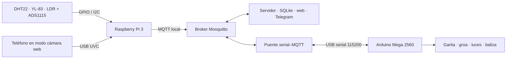
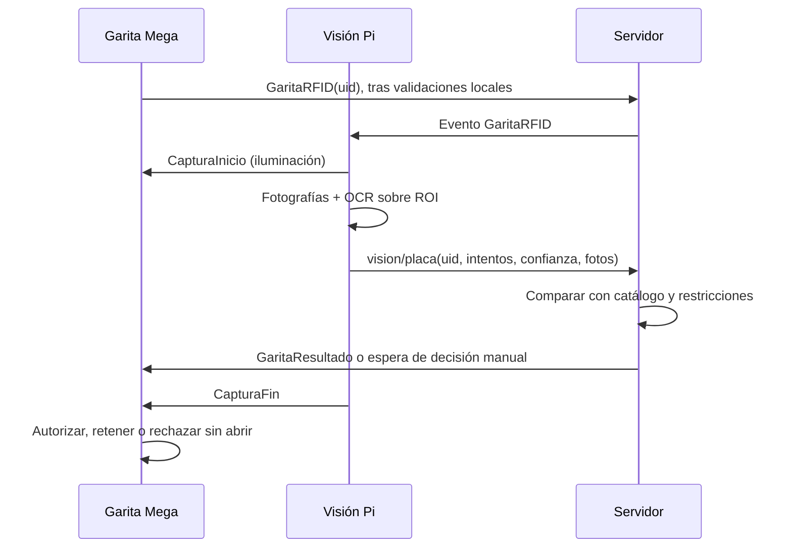

# PORTUS — Documento técnico de la fase 3

**Estado:** implementación de software revisada; construcción y validación física pendientes. Este documento describe el código disponible, no certifica resultados de la maqueta. Complementa el [documento técnico de fase 2](../Fase2/DOCUMENTO-TECNICO.md), el [mapa de pines anterior](../Fase2/MAPA-PINES-Y-HARDWARE.md) y la [guía de montaje de esta fase](GUIA-MONTAJE-Y-PRUEBAS.md).

## 1. Alcance y arquitectura

PORTUS conserva el control local de garita, grúa, pesaje, patio y salida en el Arduino Mega 2560. La Raspberry Pi 3 ejecuta el puente USB serial–MQTT, Mosquitto, servidor web, SQLite y mensajería de fase 2. Dos procesos nuevos en la misma Pi leen los sensores ambientales y procesan video. La cámara es un teléfono que debe presentarse como dispositivo USB UVC. Esta distribución sustituye la ESP32 por la Raspberry conforme al mensaje de autorización proporcionado al equipo; la adaptación debe contrastarse con los criterios de evaluación al montar la maqueta.

`PortusFase3/estacion_pi.py` y `vision_pi.py` son procesos separados. Si no se ejecutan, el modo de doble factor permanece apagado y la garita conserva el flujo local. El puente de hardware real sigue rechazando las órdenes remotas de movimiento anteriores; solamente acepta la extensión `F3` definida para esta fase.

## 2. Construcción de la estación y conexiones

La estación ambiental prevista agrupa DHT22, salida digital del comparador YL-83 y un LDR leído mediante ADS1115. Debe montarse con ventilación para el DHT22, soporte inclinado para evacuar agua del sensor de lluvia y protección de las conexiones. **La carcasa, su fuente y el diagrama eléctrico definitivo están pendientes de seleccionar y documentar con los módulos reales.** La tabla es el diseño lógico que usa el código; la [guía de montaje](GUIA-MONTAJE-Y-PRUEBAS.md) contiene el mapa completo y los puntos de comprobación.

| Señal | Conexión prevista | Condición eléctrica |
|---|---|---|
| DHT22 | Pi BCM GPIO4, pin físico 7 | Verificar alimentación y resistencia de pull-up del módulo. |
| YL-83 digital | Pi BCM GPIO17, pin físico 11 | Entrada de 3.3 V; el código interpreta LOW como lluvia. |
| ADS1115 | VDD a 3.3 V; GND a GND; SDA a BCM2/pin 3; SCL a BCM3/pin 5; ADDR a GND para `0x48` | Verificar dirección con `i2cdetect -y 1`; ninguna entrada analógica debe superar VDD. |
| LDR y resistencia fija | 3.3 V → LDR → nodo A0 del ADS1115 → resistencia fija de 10 kΩ → GND | La luz aumenta el voltaje de A0. Confirmar resistencia y voltajes reales antes de cerrar el montaje. |
| Iluminación | Mega digital 46 a entrada de MOSFET o relé | La tira usa fuente y etapa de potencia propias; el pin no la alimenta. |
| Baliza | Mega digital 47 a etapa de manejo adecuada | Verificar corriente y polaridad. |
| Mega–Pi | USB serial, normalmente `/dev/ttyACM0` | 115200 baudios; sin UART adicional. |

La lectura `luz` es un **porcentaje relativo de 0 a 100**, no lux. El código convierte el voltaje de A0 entre `--ldr-dark-voltage` y `--ldr-bright-voltage` (valores iniciales 0.0 y 3.3 V). Deben medirse ambos extremos con el LDR ya montado y ajustar los argumentos; luego comprobar los umbrales 30/45 en la maqueta. Los LDR A8–A11 del patio siguen conectados al Mega y no cambian.

**Diagrama eléctrico final por incorporar:** esquema de alimentación de la Pi y sensores, divisor LDR/ADS1115, tensión y tierra común donde corresponda, protección del GPIO17, módulo de potencia de luces y driver de la baliza. Registrar archivo editable, imagen exportada, valores de componentes y mediciones en la [bitácora](BITACORA-Y-EVIDENCIAS.md). No presentar esta tabla como sustituto de ese diagrama.

## 3. Cámara, modelos y regiones de interés

La cámara debe quedar fija frente a la garita, con la placa dentro de `plate_roi` y la zona de espera dentro de `queue_roi`. En `PortusFase3/vision_config.json` las regiones son fracciones `[x, y, ancho, alto]` del fotograma. La configuración inicial es **provisional**: captura de 640 × 480, `plate_roi=[0.5,0.35,0.4,0.3]` y `queue_roi=[0.02,0.1,0.45,0.8]`. Se deben ajustar y fotografiar sobre la maqueta real; registrar allí la imagen con ambas regiones marcadas y la posición física del soporte.

| Función | Implementación actual | Procedencia y versión |
|---|---|---|
| Lectura de placa | Tesseract OCR preentrenado mediante `pytesseract`, sobre ROI fija; escala de grises, ampliación y umbral Otsu. Se dispara por evento `GaritaRFID`. | Motor Tesseract del sistema; versión instalada pendiente de registrar con `tesseract --version`. `pytesseract>=0.3.10,<1`. |
| Conteo de vehículos | Ultralytics YOLOv8n preentrenado sobre COCO, clases automóvil, autobús y camión en la ROI de espera. | Peso público `yolov8n.pt`; `ultralytics>=8.2,<9`. Registrar versión instalada, origen y hash del peso usado antes de entregar. |

No hay detector de placas activo: se usa una ROI fija, alternativa contemplada en el enunciado cuando la detección no funciona a escala de maqueta. El conteo corre periódicamente; la lectura de placa tiene prioridad al recibir RFID. Las fotografías se guardan por intento en `PortusFase3/fotos/`. La tasa de acierto sobre al menos veinte capturas reales y la exactitud con 0–3 camiones están **pendientes** y tienen plantilla en la bitácora.

## 4. Verificación de ingreso

Primero se busca coincidencia exacta. La corrección de **un carácter** solo se acepta si existe un único candidato de igual longitud; una lectura ambigua o con confianza inferior al parámetro requiere verificación manual. La placa restringida prevalece sobre la coincidencia. Una tarjeta desconocida se rechaza. RT07 corresponde a placa distinta del RFID; RT08 a placa restringida. Ambas se desvían tras el pesaje según el firmware actual. Un resultado OCR tardío debe coincidir con el UID pendiente; una decisión manual solo se aplica al acceso pendiente actual.

El doble factor inicia apagado. Si la cámara falla, los siguientes ingresos requieren confirmación manual y la talanquera no abre automáticamente. Al reiniciar servidor o puente, o al perder el enlace del servidor por más de 15 segundos, se desactiva el modo y una verificación pendiente se rechaza con la talanquera cerrada. El operador debe comprobar enlace y cámara antes de activarlo de nuevo.

## 5. Clima, iluminación y baliza

La estación publica temperatura, humedad, lluvia y luz relativa. Ante lluvia, el servidor ordena `GruaSuspender` por clima: el Mega termina el trabajo actual y no inicia otro; la baliza parpadea sin esperas bloqueantes. Tras un periodo seco configurable, el servidor ordena la reanudación. La iluminación tiene modos Automático, Encendido forzado y Apagado forzado; en automático usa dos umbrales separados para evitar parpadeos. Antes de cada foto se ordena encenderla. Si falla o vence una lectura ambiental, se activa AL16 y la iluminación se enciende. El control del Mega usa `millis()` para iluminación y baliza.

## 6. Intercambio de mensajes

| Canal | Propósito |
|---|---|
| `portus/estacion/lectura`, `portus/estacion/estado` | Lecturas ambientales y salud de la estación. |
| `portus/estacion/config` | Periodos de lectura y latido; la estación conserva la configuración en `station_settings.json`. |
| `portus/vision/estado`, `portus/vision/placa`, `portus/vision/cola` | Salud de cámara, OCR por RFID y conteo periódico. |
| `portus/vision/config` | Confianza, intentos y periodo de conteo. |
| `portus/evt/garita` | Eventos físicos `GaritaRFID` y `GaritaModo`. |
| `portus/cmd/solicitud` | Órdenes del servidor y de visión hacia el puente. |
| `portus/fase3/latido` | Identifica la instancia del servidor para cerrar el doble factor después de un reinicio. |
| `portus/fase3/estado`, `portus/evt/clima`, `portus/evt/iluminacion` | Estado para la web y eventos de clima/luces. |

El puente traduce las órdenes nuevas a líneas `F3` por USB: `ILUMINACIONENCENDER/APAGAR`, `GRUASUSPENDER/REANUDAR CLIMA`, `CAPTURAINICIO/FIN`, `GARITAMODO ON/OFF`, `GARITARESULTADO`, `GARITAESPERA` y `PING`. Los eventos de vuelta empiezan con `@PORTUS`. Los registros de lecturas, accesos, fotos, suspensiones, placas restringidas y auditoría se añaden a SQLite sin reemplazar las tablas de fase 2.

## 7. Alarmas, parámetros y auditoría

| Código | Condición |
|---|---|
| AL16 | Estación sin enlace, lectura fallida o vencida. |
| AL17 | Suspensión por lluvia. |
| AL18 | Cámara fuera de servicio. |
| AL19 | Conteo igual o superior al umbral de cola. |
| AL20 | Placa distinta del RFID. |
| AL21 | Placa restringida. |
| AL22 | Verificación manual requerida. |

| Parámetro | Valor inicial | Uso |
|---|---:|---|
| `SegundosLecturaEstacion` | 5 | Periodo de sensores. |
| `SegundosLatidoEstacion` | 10 | Latido de estación. |
| `MinutosSinLluviaReanudar` | 2 | Espera seca antes de reanudar. |
| `UmbralLuzEncendido` / `UmbralLuzApagado` | 30 / 45 | Histéresis de luz. |
| `ConfianzaMinimaOCR` / `IntentosOCR` | 60 / 3 | Verificación de placa. |
| `SegundosEsperaVerificacion` | 10 | Aviso de decisión manual. |
| `SegundosConteoCola` / `UmbralCola` | 5 / 3 | Conteo y congestión. |

Los parámetros se validan en el servidor; el umbral de apagado debe superar al de encendido por al menos cinco unidades. Las acciones nuevas se registran en `fase3_auditoria`: cambio de iluminación, decisión manual, cambios del catálogo y restricciones, inicio y fin de suspensión por lluvia. La plataforma añade Accesos, Placas restringidas, parámetros de fase 3 y `/clima` en Telegram. Confirmar cada salida con pruebas físicas antes de declararla operativa.

## 8. Instalación, límites y entregables pendientes

La instalación y el orden de encendido están en la [guía de montaje](GUIA-MONTAJE-Y-PRUEBAS.md). En la Pi se instalan `PortusFase3/requirements-pi.txt`, Tesseract, Mosquitto y las dependencias de fase 2; se habilita I2C, se comprueba `/dev/video*` y se calibran el divisor LDR y las ROI. El archivo `yolov8n.pt` no está versionado y debe quedar disponible localmente.

Faltan el diagrama eléctrico definitivo, fotos de la estación y cámara montadas, versiones instaladas de los modelos, veinte lecturas de placa, mediciones de cola, pruebas E01–E13 y evidencias 3D. Se registran en la [bitácora](BITACORA-Y-EVIDENCIAS.md) y el [inventario 3D](INVENTARIO-FABRICACION-3D.md). El guion y la presentación se incorporarán cuando estén cerrados para la entrega.
